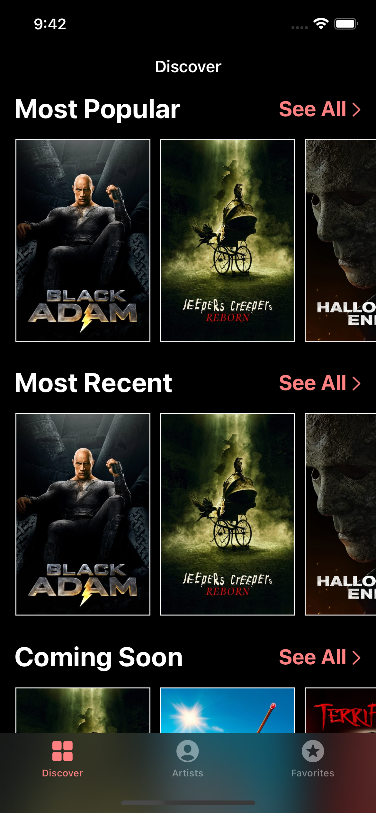
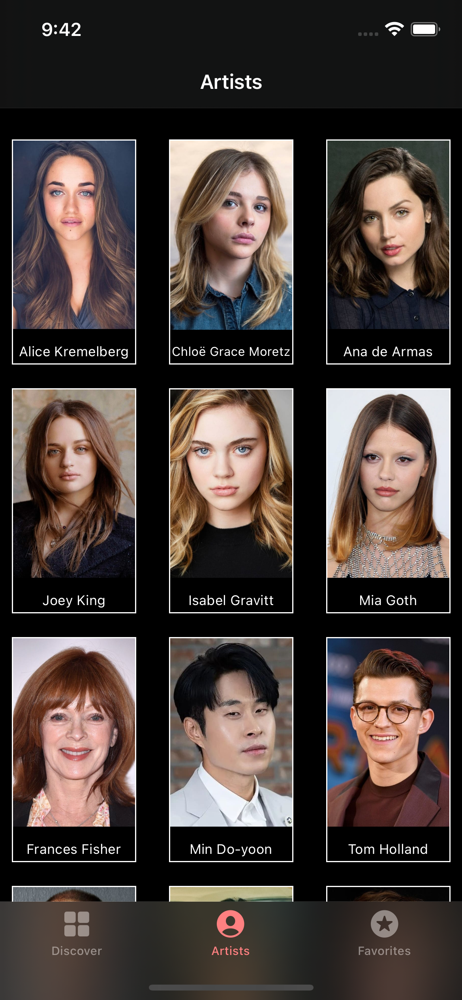
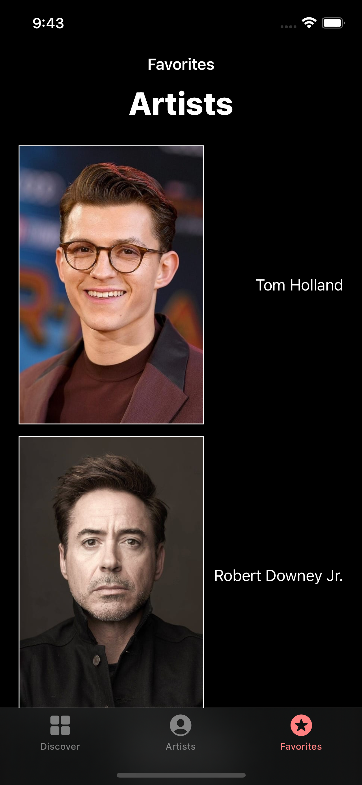
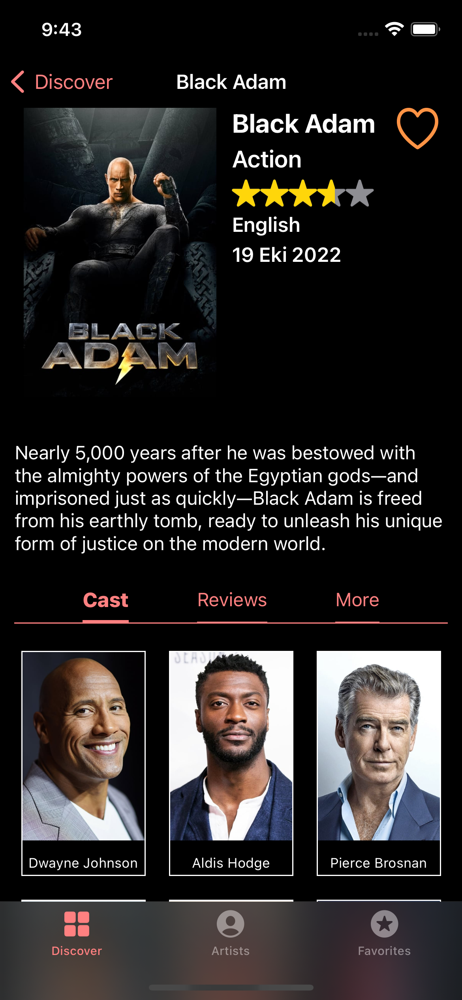
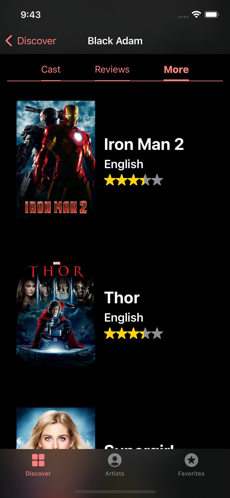
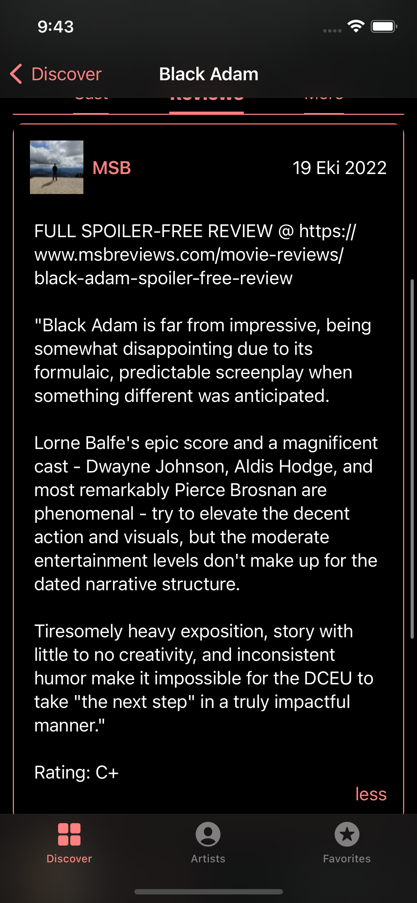
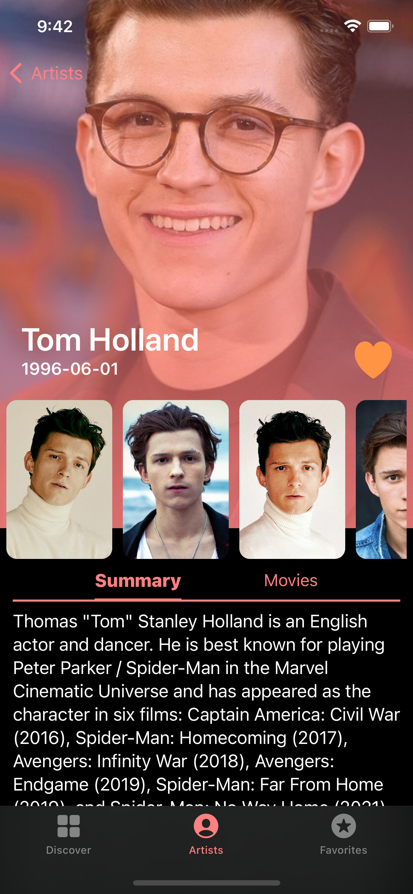
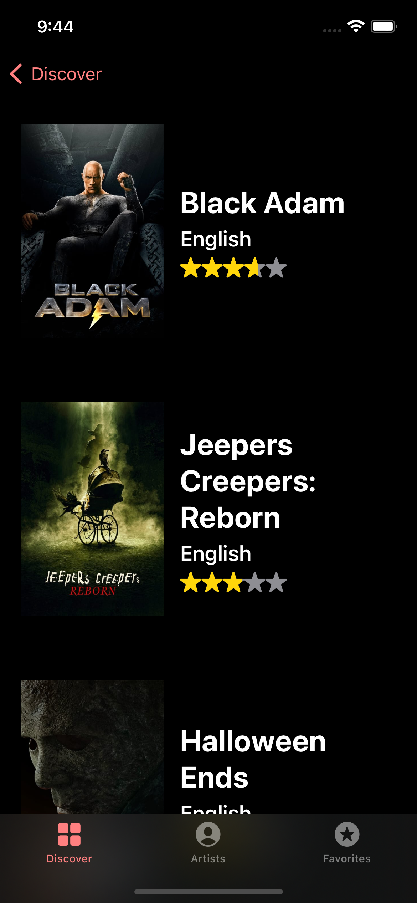

# Watchlist

Watchlist is a Movie/Series Listing app. Will be used as a workspace for learning swiftUI. TMDB will be used as Backend. 

# Features

- SwiftUI
- Used VIPER
- Swiftlint and Kingfisher as 3rd party libraries.
- Supports both Movies and TV Series
- Unit Tests
- Core Data for favoriting movies, series and artists
- Dark/Light theme support

# Screenshots

- Dashboard



- Artist List



- Favorites List



- Movie Detail



- Movie More/Similar



- Movie Review



- Artist Detail



- See All Movies/Series




## Modern iOS architecture

The app supports **iOS 18 and later**. `SDKROOT = iphoneos` uses the SDK bundled
with the selected Xcode, rather than pinning an SDK version. The modernization
was prepared with locally installed Xcode 27.2 / iOS 27.2 SDK; Swift language mode
and the existing Kingfisher requirement remain unchanged.

- `Core/AppDependencies.swift` is the root composition boundary. Production and
  offline UI-test implementations build feature presenters with independent state.
  Factory is not currently a dependency; constructor injection avoids adding one.
- Feature folders retain their VIPER interfaces and existing implementation names.
  Presenters use `@MainActor` and `@Observable`; screen-owned references use `@State`.
- Loading methods are now `async`. Call them with `await` from `.task` or an
  explicit user-action task, never from a view initializer. Tests await completion
  directly, without Combine subscriptions or timing delays.
- Root screens use `NavigationStack`, and the dashboard uses typed iOS 18 `Tab`
  items. Detail layouts size themselves to their container instead of the screen.
- Loading flags prevent overlapping requests and reset with `defer`. Failures are
  exposed to alerts; cancellation does not display an error. Discovery sections
  load independently, and cumulative results replace previous section contents.
- Review, similar-media and media-fetcher page counters advance only after a
  successful, uncancelled response. Media fetchers deduplicate cumulative IDs.
- Favorite stores accept injected contexts, avoid duplicate insertion and reject
  IDs that cannot fit the existing Core Data model. Favorite storage and its
  interactor run on the main actor to respect the view context's queue.
- The request manager accepts both transport and parser dependencies. HTTP
  transport accepts the full successful 2xx range without logging request URLs.

## Verification and coverage

Use the **project**, not the legacy workspace. Select an installed simulator:

```sh
xcodebuild -project Watchlist.xcodeproj -scheme Watchlist -showdestinations
xcodebuild -project Watchlist.xcodeproj -scheme Watchlist \
  -destination 'platform=iOS Simulator,name=<installed simulator name>' \
  -enableCodeCoverage YES -resultBundlePath /tmp/WatchlistTests.xcresult test
xcrun xccov view --report /tmp/WatchlistTests.xcresult
```

The suite includes all 11 presenter test classes, failure/recovery and cancellation
cases, overlapping artist loads, pagination retries, repeated-load regressions,
request encoding, response decoding, HTTP status validation, strategy routing,
in-memory favorite storage, and offline root-tab navigation. UI tests launch with
`--ui-testing`; this dependency override is compiled only in Debug.

**Verification status:** Swift syntax parsing and project-file validation passed.
An executable build/test run could not be completed in the editing environment:
CoreSimulator access was denied, the initial package fetch could not resolve
GitHub, and the cached-package attempt was blocked by SwiftPM's sandbox setup.
Consequently, test success and full-codebase coverage are **not verified**.
Syntax parsing does not replace compilation, macro expansion, or simulator tests.

Remaining work before calling coverage complete includes measured line/branch
coverage, model decoding edge cases, every service/interactor forwarding path,
persistent-store failure/migration behavior, detail navigation and favorite
interaction UI tests, accessibility, and device/layout checks. Existing
persistent-store and favorite-storage fatal-error handling also remains to be
redesigned rather than silently substituting an empty database on failure.

The unused legacy `AppSettings`, `TabItemView`, and Combine test helper remain
in place, per the project rule against deleting unused code without a request.

## Catalog UI refresh

The shared UI components live in `Watchlist/Common/Views/Catalog` and are
registered in the application target. Poster sizing, card metadata, section
headers, detail content, and movie/TV destination selection are shared across
Discover, Favorites and lists.

- Discover features a backdrop spotlight, smaller section headings, snapping
  poster rows, titles and ratings. The existing TV endpoint is labeled Popular TV.
- Favorites has All / Movies / TV / Artists filters, section counts, tappable
  cards, pull-to-refresh, and one consistent 20-point inset around all grids.
- Artist grids use larger adaptive cards with readable names. Profile pages use
  bounded portraits, a photo strip and native About / Filmography controls;
  biography emphasis is rendered without losing paragraph breaks.
- Movie/TV details share a readable summary and native segmented controls.
  Nested vertical scrolling was removed from the embedded cast/review/similar
  sections. Preview data is hidden until a real detail payload loads successfully.
- Cards have image placeholders, system light/dark surfaces and semantic fonts.
  Favorite buttons have labeled 48-point hit targets and selection feedback.

Regression coverage adds offline Favorites filter/empty-state/margin UI checks
and unit cases for missing and incorrect detail payloads. Run the UI test on
both a compact iPhone and a larger device, in light/dark mode and at larger text
sizes. These new UI tests and the visual layouts still require simulator
verification: the latest `xcodebuild build-for-testing` attempt was blocked at
SwiftPM cache access by the editing environment, before compilation.
